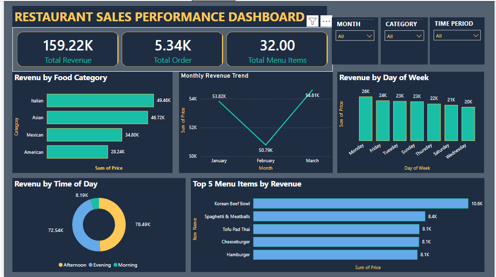

# Restaurant Sales Analysis – Q1 2023

## Project Overview

This project analyses restaurant sales data for the first quarter of 2023 (January–March) to uncover sales trends, identify top-performing menu items and understand customer purchasing patterns.

The goal was to transform raw sales data into meaningful business insights that can support better decision-making.

## Business Questions

- Which food category generated the highest revenue?
- Which month recorded the highest sales?
- Which days and times generated the most revenue?
- Which menu items performed best by revenue and order quantity?
- What business actions could improve sales performance?

## Dataset Description

The dataset was obtained from Maven Analytics and contains restaurant order details and menu information.

- Period covered: January–March 2023
- Original order detail records: 12,234
- Records retained for analysis: 12,097
- Menu items analysed: 32

## Tools Used

- Microsoft Excel – Data cleaning, calculations and exploratory analysis.
- Microsoft Power BI – Data visualisation and interactive dashboard.

## Data Cleaning and Preparation

- Reviewed the order details and menu items datasets.
- Matched menu item IDs with menu information.
- Identified 137 records with missing item IDs.
- Excluded records with missing item IDs from the revenue analysis.
- Prepared the cleaned data for analysis and visualisation.

## Key Findings

### Revenue Performance

- Total revenue: 159,217.90
- Italian food generated the highest category revenue: 49,462.70.
- American food generated the lowest category revenue: 28,237.75.
- March recorded the highest monthly revenue: 54,610.60.
- February recorded the lowest monthly revenue: 50,790.35.

### Sales Patterns

- Monday recorded the highest revenue among the days of the week.
- Wednesday recorded the lowest daily revenue.
- Afternoon generated the highest revenue: 78,489.90.
- Morning generated the lowest revenue: 8,185.85.

### Top-Performing Menu Items

**Highest Revenue:**
1. Korean Beef Bowl – 10,554.60
2. Spaghetti & Meatballs – 8,436.50
3. Tofu Pad Thai – 8,149.00
4. Cheeseburger – 8,132.85
5. Hamburger – 8,054.90

**Highest Order Quantity:**
1. Hamburger – 622 orders
2. Edamame – 620 orders
3. Korean Beef Bowl – 588 orders
4. Cheeseburger – 583 orders
5. French Fries – 571 orders

## Business Recommendations

Based on the findings, the following actions are recommended:

- Maintain the quality and availability of popular Italian menu items, which generated the highest category revenue.
- Consider promotional campaigns for high-performing items such as Korean Beef Bowl and Hamburger.
- Investigate the reasons behind lower Wednesday sales and explore targeted promotions.
- Review morning sales performance and consider breakfast offers or other incentives to attract more customers.
- Continue monitoring monthly sales trends to identify opportunities for growth.

## Power BI Dashboard

The interactive Power BI dashboard presents key performance indicators, revenue trends, category performance, time-of-day performance and top-selling menu items.

## Project Files

- `Restaurant_Sales_Analysis.xlsx` – Excel analysis workbook.
- `Restaurant Sales Performance Dashboard.pbix` – Power BI dashboard file.
- `Restaurant_Sales_Dashboard.png` – Dashboard screenshot.

## Conclusion

This project demonstrates how Excel and Power BI can be used to clean, analyse and visualise business data, uncover meaningful patterns and generate actionable recommendations.

## Download Project Files

- [Download Excel Workbook](./Restaurant_Sales_Analysis.xlsx)
- [Download Power BI Dashboard](./Restaurant%20Sales%20Performance%20Dashboard.pbix)
- [View Dashboard Screenshot](./Restaurant_Sales_Dashboard.png)

More data analytics projects will be added as I continue developing my skills.
